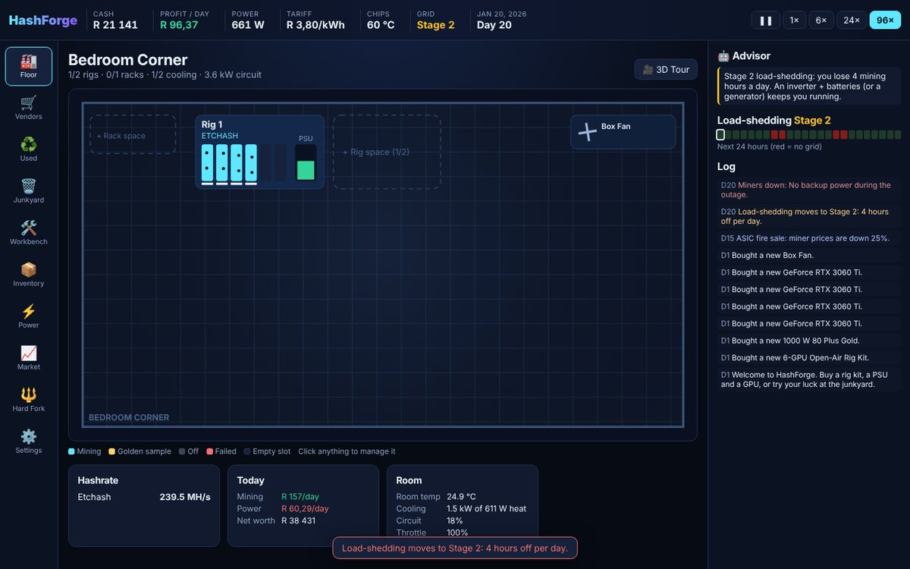
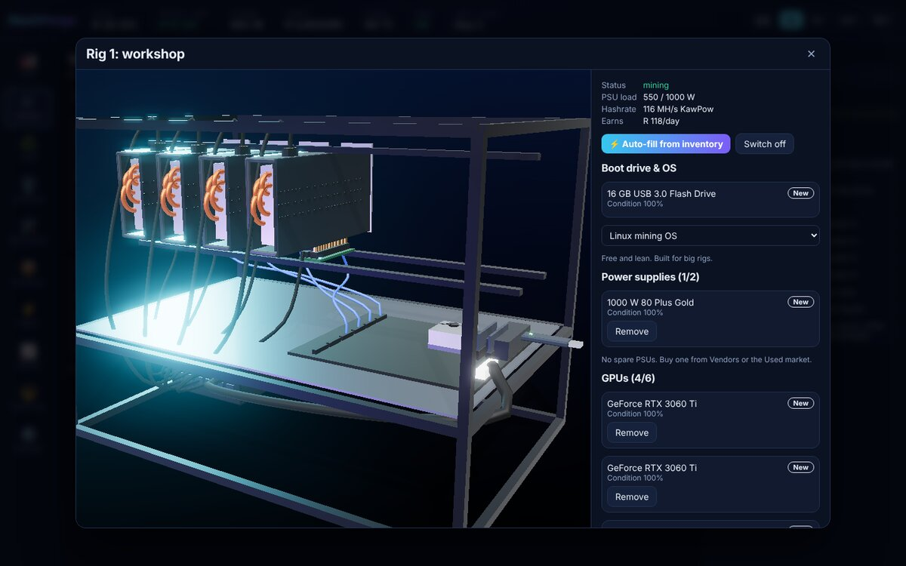
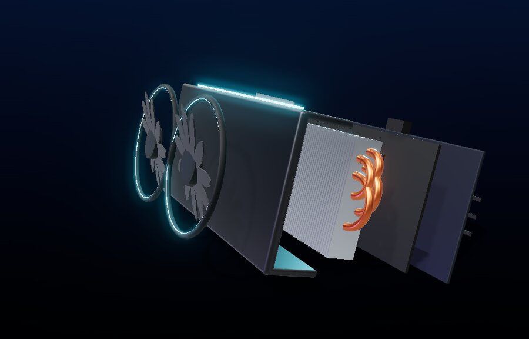
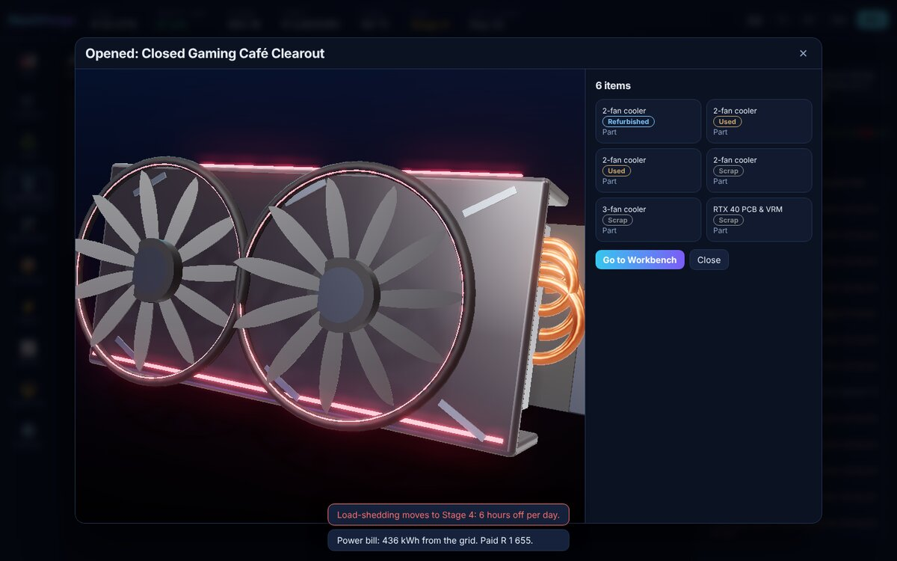
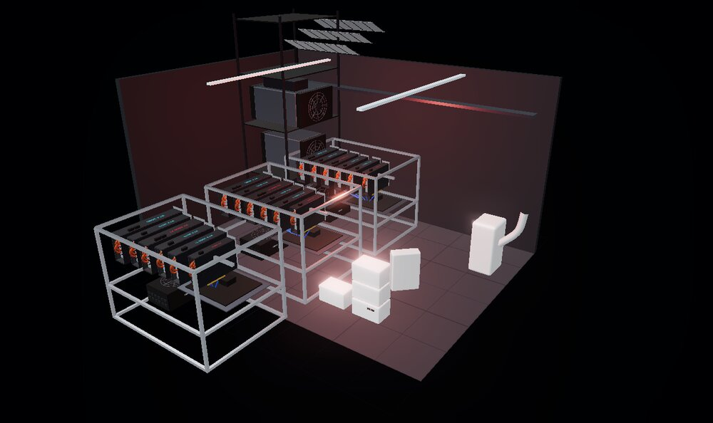
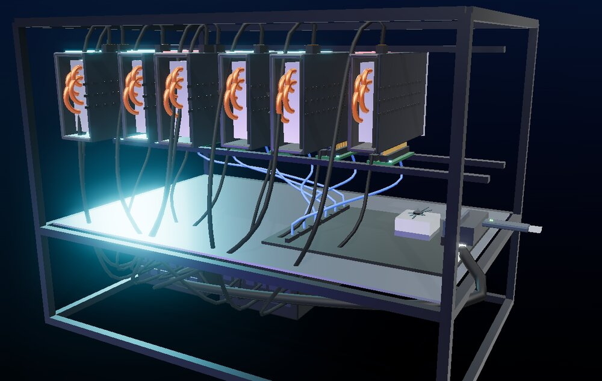
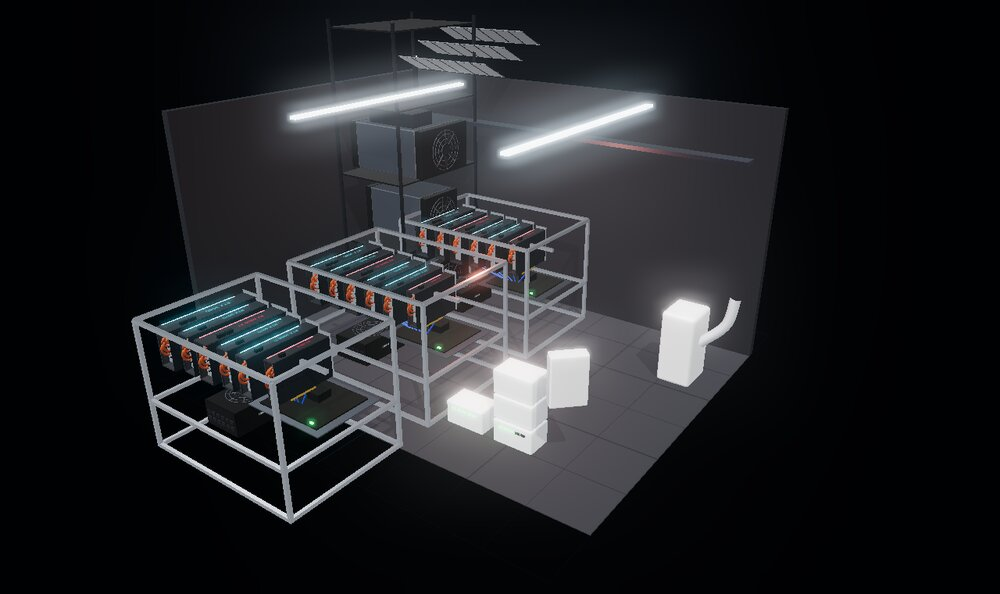

<h1 align="center">⛏️ HashForge</h1>

<p align="center"><b>Build GPU & ASIC mining rigs, survive load-shedding, pay the power bill, and grow a hashrate empire.</b><br>
A mining tycoon that runs in your browser: 2D management, 3D hands-on hardware.</p>

<p align="center">
  <a href="https://github.com/BullisticZA/hashforge/actions/workflows/ci.yml"></a>
  
  
  
</p>

<p align="center"><b>▶ Play now:</b> <a href="https://bullisticza.github.io/hashforge/">bullisticza.github.io/hashforge</a></p>

<p align="center"></p>

---

## 🎮 What you do

Start in a bedroom corner with a little savings and a dream. Buy a rig kit, a power supply and a few graphics cards, or dig through the **junkyard** for broken cards and parts and build your own on the **workbench**. Watch the power bill. Survive **load-shedding**. Expand to a garage, a warehouse, then a hydro-powered mining hall. When you've built an empire, **Hard Fork**: reset for permanent upgrades and start a harder era.

| | |
|---|---|
|  |  |
| **3D rig workshop:** install cards and PSUs, see every riser and heatpipe | **Exploded view:** fans, shroud, fin stack, heatpipes, PCB, backplate |
|  |  |
| **Junkyard:** open lots, find parts, hunt golden samples | **Load-shedding:** the lights die, fans stop, the money stops |
|  |  |
| **Risers & cabling:** every card on a riser, USB to the motherboard, PCIe power into each socket | **3D tour:** walk your whole operation |

## ✨ Features

- **240+ pieces of hardware**, each with its own 3D model and specs:
  - **91 GPUs:** GeForce RTX 50 back to GTX 10, Radeon RX 9000 back to RX 400, Intel Arc, TITAN and workstation cards, headless CMP, P104 and P106 mining cards, and passive datacenter cards like the A100 and Instinct MI50
  - **62 ASIC miners:** Bitmain, MicroBT, Canaan, IceRiver, Goldshell, Jasminer, Elphapex, VolcMiner and Innosilicon, including water-cooled hydro units, home-heater miners and tiny open-source boards
  - **Power and site gear:** 14 PSUs, 8 rig frames, 7 racks (up to a 20 ft container pod), 15 cooling units (box fans to evaporative towers, chillers and immersion tanks), 8 inverters, 8 batteries, 7 solar arrays, 4 generators
  - **Rig parts and mods:** 7 riser types, 7 boot drives, thermal pads, copper shims, fresh thermal paste and replacement fans
- Shop **search and sort** by profit, payback time, price or release year
- **Goals** that walk you through your first rig, then endless profit milestones that double each time, with cash rewards
- **Build from the Floor:** click a rig to see what's in it and what's in your inventory, add or remove parts, or Auto-fill. New purchases install themselves into a rig with room
- **Time away counts:** come back to a "Welcome back" report (1 game hour per real minute, up to a game week)
- **Six algorithms:** SHA-256, Scrypt, kHeavyHash, KawPow, Etchash, Autolykos2. Rigs auto-switch to the most profitable
- **Vendors, a used marketplace and a junkyard**, with quality grades from Scrap to **Golden Sample**
- **GPU crafting:** match a core, memory, PCB and cooler; salvage cards back into parts
- **Realistic rigs:** PCIe risers (cheap SATA ones can catch fire), USB riser cables, boot drives, Linux or Windows mining OS, thermal pads and copper shims
- **Real power engineering:** PSU load and efficiency, circuit breakers, rack PDUs, heat and throttling, AC and immersion cooling
- **Load-shedding stages 1–8**, solar that follows the sun, seasons and clouds, hybrid inverters that trip when overloaded, batteries that wear out, diesel generators
- **Your currency:** detects South Africa (Rand) and other regions, uses a typical tariff you can edit, and converts at live exchange rates
- **Wear and failures**, repairs and servicing; a market with bull runs, crashes, rising difficulty and halvings
- **Prestige:** Hard Fork for Fork Shards and 8 endlessly-levelling upgrades; every era is harder
- **Advisor** that spots problems: overloaded PSUs, unprofitable miners, inverter limits, heat
- Saves automatically in your browser. No account, no install, works offline

See the [ROADMAP](ROADMAP.md) for what's next: PC and server building, networking and firewalls, hosting for clients, and much more.

## 🕹️ Controls

| Key / action | What it does |
|---|---|
| `Space` | Pause / resume |
| `1`–`4` | Game speed (1, 6, 24, 96 game hours per second) |
| Click a rig or rack | Manage it; **Open in 3D workshop** to install parts |
| 🎥 3D Tour | Walk around your whole operation in 3D |
| `Esc` | Close a 3D view |

## 🛠️ Run it locally

No build step. On Windows, double-click **`Play HashForge.bat`**: it starts a tiny local server with PowerShell and opens the game in your browser. Opening `index.html` directly will show a blank page, because browsers block the game's scripts when a page is opened from disk.

Or serve the folder with any static web server:

```bash
git clone https://github.com/BullisticZA/hashforge.git
cd hashforge
python -m http.server 8000      # then open http://localhost:8000
```

Run the simulation tests (Node 20+):

```bash
node --test tests/*.test.mjs
```

The game logic (`js/sim/engine.js`) is pure JavaScript with no DOM, so every rule (power dispatch, load-shedding, heat, wear, crafting, prestige, economy balance) is covered by tests.

## 📜 License & credits

[MIT](LICENSE) © 2026 Charl Britz. 3D rendering by [three.js](https://threejs.org) (MIT).

Hardware names identify real products and belong to their respective owners. HashForge is not affiliated with or endorsed by any manufacturer. All 3D models are original artwork, not replicas of product designs. Hash rates, prices and tariffs are approximations, and coin prices are simulated. This is a game, not financial advice.
